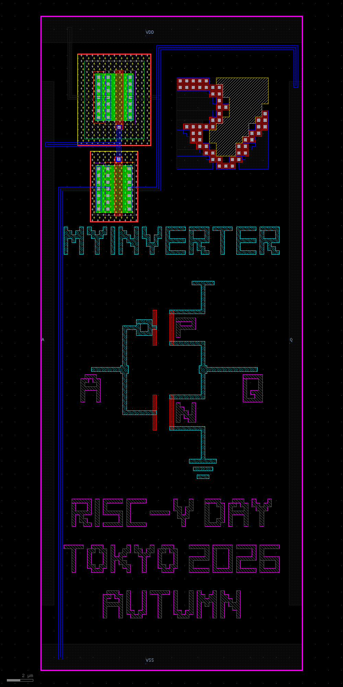

# DUT 065 Datasheet

## DUT

DUT name: `inv_dut_065`

| Device | Model | W | L | Fingers | Multiplier |
|--------|-------|---|---|---------|------------|
| PMOS | pfet_05v0 | 3.60 um | 0.60 um | 1 | 1 |
| NMOS | nfet_05v0 | 3.60 um | 0.60 um | 1 | 1 |

The parameters match DUT 065 in `dut_params.csv`.

## Layout notes

- One PMOS and one NMOS form a CMOS inverter. The terminals are VDD, VSS, A (input), and Q (output).
- The circuit uses Metal1 routing. MOS dimensions and the template boundary/pins are preserved.
- The transistors occupy the upper-left area. The output route runs along the upper side.
- Isolated artwork includes a RISC-V logo, a PMOS/NMOS inverter diagram, and the event title.
- The blue logo uses Metal1; yellow uses Metal5. The white portions use 53 field-poly contacts (0.22 um square, 0.50 um pitch) with Poly2/Metal1 enclosure.
- The central schematic drawing uses field Poly2 and metal artwork. It does not add active/COMP regions or MOS devices and is not connected to the inverter.
- Default PDK display colors are used; no custom layer-properties file is required.
- Density and parasitic extraction are not included in the template checks.

## Author

- Name: KaitoSanuki
- GitHub: https://github.com/KaitoSanuki

## License

See the repository `LICENSE`. The RISC-V logo is a third-party mark included in the layout artwork.
